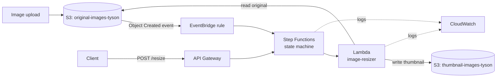
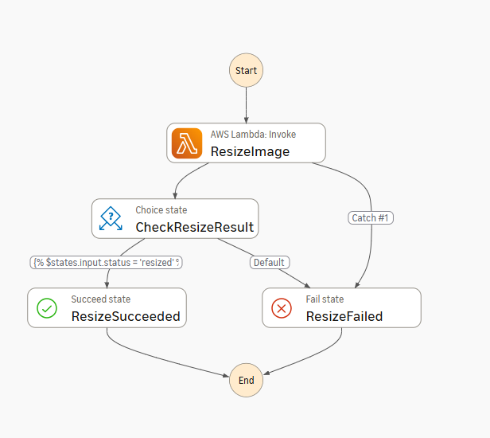
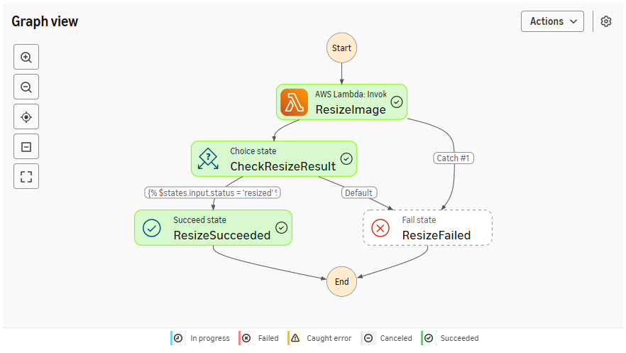
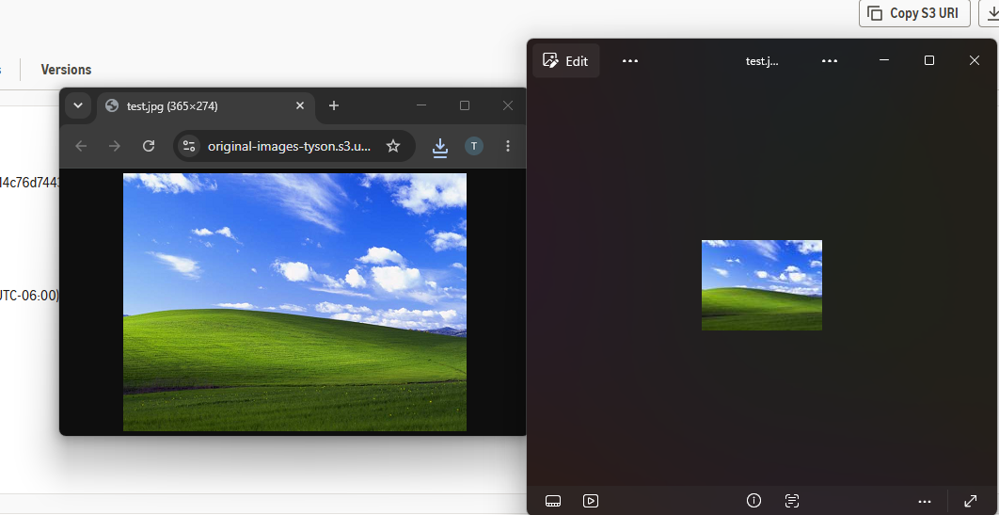
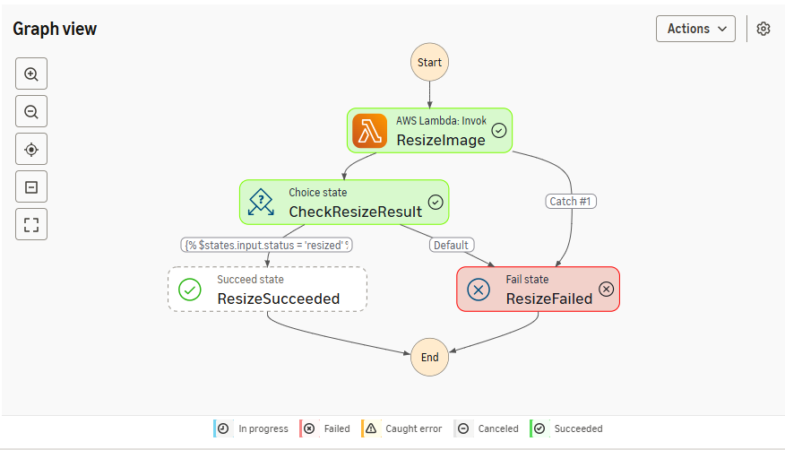

# Serverless Image Processing Pipeline

A serverless AWS pipeline that automatically resizes images into thumbnails.
Uploading an image to an S3 bucket (or calling a REST API) starts a Step
Functions workflow that runs a Lambda function to create the thumbnail and
store it in a second bucket.

Built as the capstone project for CCMP-200: Cloud Computing, Saskatchewan Polytechnic.

## Architecture



There are two ways to start the workflow, and both run the same state machine:

1. **Upload trigger:** an image uploaded to the original bucket sends an event
   to EventBridge, and a rule starts the state machine.
2. **API trigger:** a `POST` to the API Gateway endpoint starts the state
   machine for an image already in the original bucket.

The Lambda function is only ever invoked by Step Functions.

## Workflow

The state machine (see [`state-machine/`](state-machine/)) has four states:

1. **ResizeImage** (Task): invokes the Lambda with the bucket and key.
2. **CheckResizeResult** (Choice): checks the `status` returned by the Lambda.
3. **ResizeSucceeded** (Succeed): the status was `resized`.
4. **ResizeFailed** (Fail): the status was anything else, or the Lambda raised an error.

<!-- Add the state machine graph screenshot here -->


## AWS services used

| Service | Role in the project |
|---|---|
| Amazon S3 | Two buckets: `original-images-tyson` (uploads) and `thumbnail-images-tyson` (results) |
| AWS Lambda | Python 3.12 function that resizes images with Pillow (via a Lambda layer) |
| AWS Step Functions | Orchestrates the workflow (JSONata query language) |
| Amazon API Gateway | REST endpoint that starts the state machine |
| Amazon EventBridge | Starts the state machine when an image is uploaded |
| AWS IAM | Least-privilege roles for each service |
| Amazon CloudWatch | Logs from Lambda and Step Functions |

## Repository structure

| Folder | Contents |
|---|---|
| [`pillow-layer/`](pillow-layer/) | Script that builds and publishes the Pillow Lambda layer |
| [`lambda/`](lambda/) | The resize function source code |
| [`state-machine/`](state-machine/) | Step Functions definition (Amazon States Language) |
| [`api-gateway/`](api-gateway/) | API mapping template and endpoint documentation |
| [`eventbridge-trigger/`](eventbridge-trigger/) | Upload trigger rule definition |
| [`IAM-Policies/`](IAM-Policies/) | IAM policies and a summary of every role |
| [`screenshots/`](screenshots/) | Screenshots |

Each folder has its own README with detailed steps.

## Prerequisites

- An AWS account, working in **us-east-1** (all resources must be in one region)
- Access to AWS CloudShell (used to build the Lambda layer)
- Your 12-digit AWS account ID, to replace `ACCOUNT_ID` in the policy and
  definition files
- Optional: the AWS CLI or Postman for testing the API

## Deployment

Deploy in this order, since each step depends on the previous ones. Follow the
linked README for detailed steps.

1. **S3 buckets:** create `original-images-tyson` and `thumbnail-images-tyson`
   with default settings and Block Public Access on. If these names are taken,
   choose others and update them everywhere they appear.
2. **Pillow layer:** run [`pillow-layer/build-layer.sh`](pillow-layer/) in CloudShell.
3. **Lambda function:** create `image-resizer` and attach the layer. See
   [`lambda/`](lambda/) and [`IAM-Policies/`](IAM-Policies/) for the S3 permissions.
4. **State machine:** create `image-resize-workflow` from
   [`statemachine/image-resize.asl.json`](statemachine/), with logging on.
5. **API Gateway:** create the IAM role, then the REST API. See
   [`api-gateway/`](api-gateway/) and [`IAM-Policies/`](IAM-Policies/).
6. **Upload trigger:** enable EventBridge notifications on the original bucket
   and create the rule. See [`eventbridge-trigger/`](eventbridge-trigger/).

## Usage

### Option 1: upload an image

Upload an image to `original-images-tyson` through the S3 console or the CLI:

```bash
aws s3 cp photo.jpg s3://original-images-tyson/photo.jpg
```

The workflow starts automatically, and `thumb-photo.jpg` appears in
`thumbnail-images-tyson` within a few seconds.

### Option 2: call the API

For an image already in the original bucket:

```bash
curl -X POST https://<api-id>.execute-api.us-east-1.amazonaws.com/dev/resize \
  -H "Content-Type: application/json" \
  -d '{"bucket": "original-images-tyson", "key": "photo.jpg"}'
```

PowerShell:

```powershell
$body = @{ bucket = "original-images-tyson"; key = "photo.jpg" } | ConvertTo-Json
Invoke-RestMethod -Method Post -Uri "https://<api-id>.execute-api.us-east-1.amazonaws.com/dev/resize" -ContentType "application/json" -Body $body
```

The response contains an `executionArn`. The workflow runs asynchronously, so
check the result in Step Functions.

## Testing

| Test | Action | Expected result |
|---|---|---|
| Upload trigger | Upload an image to the original bucket | Green execution; `thumb-<name>` in the thumbnail bucket |
| API trigger | POST to `/resize` | Response with `executionArn`; green execution |
| Failure path | Upload a non-image file (such as a `.txt`) | Execution ends in **Failed** with `ResizeError`; no thumbnail |
| Logging | Open the `/aws/lambda/image-resizer` log group | `Resized ...` or `Failed to resize ...` entries |

<!-- Add screenshots below -->




## Design notes

- **Separate buckets:** thumbnails go to a different bucket so writing a
  thumbnail can never retrigger the pipeline.
- **Explicit status:** the Lambda returns `"status": "resized"` or `"failed"`,
  which lets the state machine's Choice state decide the outcome.
- **Least privilege:** each role only has the permissions it needs (see [`IAM-Policies/`](IAM-Policies/)).
- **JSONata:** the state machine uses JSONata for input and output mapping
  instead of JSONPath.

## Possible improvements

- Restrict the API with IAM authorization or an API key (it is currently open)
- Validate file types before processing
- Generate multiple thumbnail sizes
- Add a dead-letter queue or notification for failed executions

## Cleanup

To avoid leaving resources running after using, delete:

1. The EventBridge rule and the API Gateway API
2. The Step Functions state machine
3. The Lambda function and the `pillow-layer` layer
4. Both S3 buckets (empty them first)
5. The IAM roles listed in [`IAM-Policies/`](IAM-Policies/)
6. The CloudWatch log groups

## Author

Tyson Bennett
Business Information Systems student
Saskatchewan Polytechnic